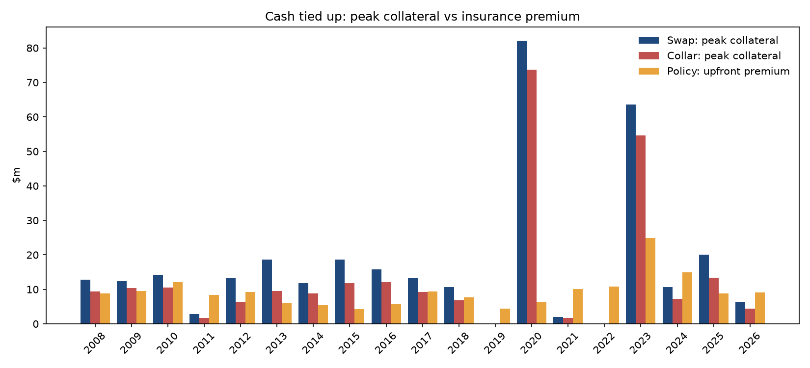

# Jet fuel protection: insurance-style caps vs traditional hedges

[](https://jet-fuel-hedging.streamlit.app)

How would an airline have fared over 2008–2026 protecting itself against fuel price rises with a swap, a zero-cost collar or a trigger–cap insurance policy, compared with doing nothing? This project replays history month by month for a hypothetical airline that protects 60% of its fuel, setting up each year's protection in December using only the information available at the time.

**Read more:** [full report](reports/jet_fuel_report.pdf) · [live dashboard](https://jet-fuel-hedging.streamlit.app)

## Main findings

- **The swap gives the most certainty.** It removed 84% of the uncertainty in the monthly fuel bill, against 72% for the collar and 37% for the policy. The policy's 10% trigger and its cap limit what it covers.
- **The policy wins when prices fall.** It was cheaper than the swap in 4 of 19 years (2014, 2015, 2020 and 2023), all years in which prices fell after the hedge was set. In 2020 the swap left the airline paying $1.61 a gallon against a market price of $1.10; the policy cost $1.15.
- **The real difference is cash.** Swaps and collars need collateral when prices fall. Peak swap collateral exceeded the policy's upfront premium in 13 of 19 years, reaching $82.0m in 2020 against a $6.2m premium.
- **Pricing on past volatility underprices spikes.** The policy paid out $195.6m against $172.9m in premiums, so an insurer would have needed a loading of at least 41% to break even.
- **The conclusions are robust.** The policy beat the swap in 4–6 years under every loading (0–50%) and trigger (0–20%) tested.



## Main assumptions

One decision date a year (31 December), a flat forward curve (forward price = spot price), Black-76 pricing on trailing one-year realised volatility with a 25% insurer loading, and daily margining with no threshold. The most important limitation is the single decision date: real airlines layer hedges 12–24 months ahead. Full details are in the [report](reports/jet_fuel_report.pdf).

Data: US Gulf Coast jet fuel spot prices, FRED series `DJFUELUSGULF`, January 2007 to October 2026.

## How to run

```bash
pip install -r requirements.txt
python -m pytest -q                  # unit tests
python -m scripts.run_backtest       # tables and charts saved to results/
streamlit run app/dashboard.py       # interactive dashboard
```

## Project structure

```
src/        data loading, volatility, Black-76 pricing, strategy payoffs, backtest, collateral
scripts/    full analysis, saves tables and charts
app/        Streamlit dashboard
tests/      unit tests for pricing, payoffs and the backtest
reports/    two-page brief and full report
```
